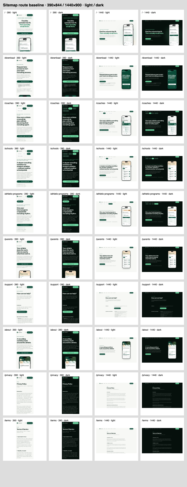

# Route smoke and screenshots

The harness captures every URL from the built site's `/sitemap.xml` using a fresh, owned `next start` server bound to loopback. It checks 390×844 and 1440×900 in light and dark browser color schemes. It does not rewrite the site's theme or visible content.

```sh
pnpm install --frozen-lockfile
pnpm exec playwright install chromium
pnpm test:shoot
pnpm typecheck
pnpm build
pnpm shoot
```

Use Node 24 as required by `package.json`. Linux runners may need `pnpm exec playwright install --with-deps chromium`. To use an already-installed Chrome instead, set `SHOOT_CHANNEL=chrome` for the test and shoot commands. The build is intentionally explicit; `shoot` runs the existing production build, never a dev server or the deployed website.

Outputs are gitignored under `.shots/`: full-page PNGs, viewport PNGs, `contact-sheet.png`, `report.json`, and `server.log`. The contact sheet shows the first viewport; full-page files retain the complete route. Each row is one sitemap route with mobile light/dark and desktop light/dark columns. Fixtures verify real browser overflow and alt detection, console-error capture, URL normalization, mutation-method blocking, missing links/fragments, redirects, and redirect loops.

Any console error, uncaught page error, failed route/navigation, 390px document overflow, image missing an `alt` attribute, or broken internal link makes the command exit nonzero. Empty decorative `alt=""` is valid. Links include relative links and canonical site hosts from the sitemap; checks cover HTTP status and HTML fragments, including locally resolved redirects. External destinations are not probed. Sitemap indexes deliberately fail with a clear error instead of silently missing routes.

No forms or buttons are submitted. Browser requests with write methods (including analytics POST/beacons) receive a local 204 and are recorded in the report. Service workers are disabled. Page reads and static asset reads are allowed; this is a local rendering check, not an offline test. Link probes use local GET only and never follow an external redirect.

## Main baseline

Recorded October 28, 2026 against unchanged site source at `df915cb41ad1484ff06c1405a4d4803cc3970b43` (the complete SHA is retained in the JSON report). Node 24.19.0, pnpm 10.18.3, Playwright 1.64.1 / Chromium 156.0.8078.4; no production env file copied into this checkout.

- `pnpm test:shoot`: 5 test groups pass. An earlier fixture rerun hit a local keep-alive ECONNRESET under machine load; the final run passes with explicit fixture keep-alive and one transport-reset retry in link probes. HTTP errors are never retried into success.
- `pnpm typecheck` and `pnpm build`: pass. No `pnpm lint` invocation.
- `pnpm shoot`: 10 sitemap routes × 4 viewport/color combinations = 40 captures, each with full-page and viewport PNG; zero console/page errors, mobile overflows, missing-alt images, broken links or missing fragments.
- 24 distinct internal links passed; zero mutation requests observed or submitted. Counts are in the [saved report](s2-report-1028.json).



The contact sheet is committed only as review evidence. Runtime captures remain ignored. The source baseline and local rendering checks do not establish production deployment or app-download readiness.
